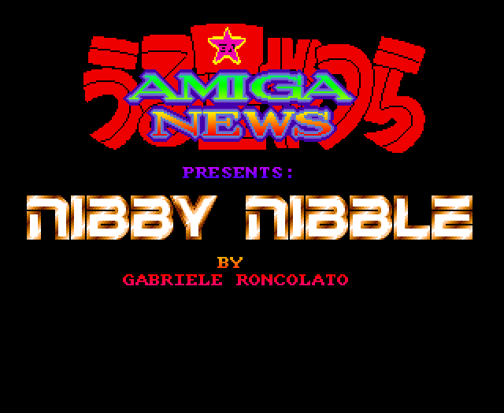
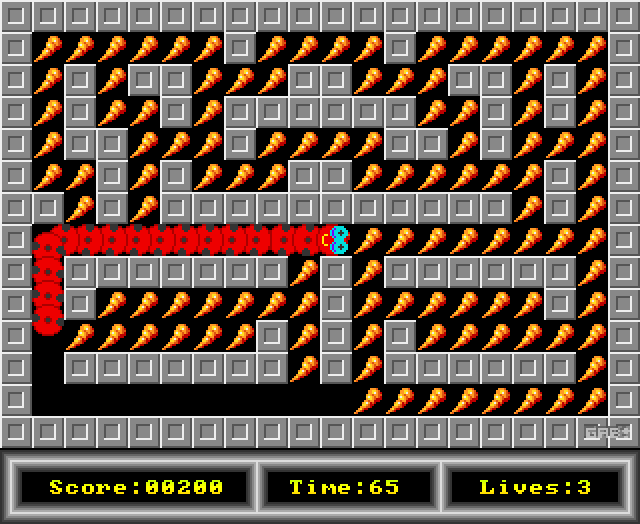
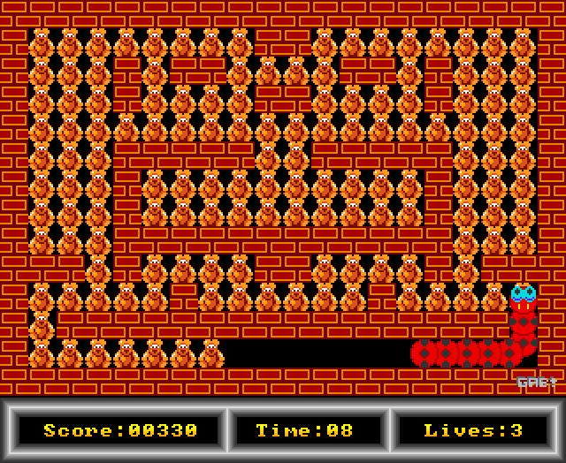
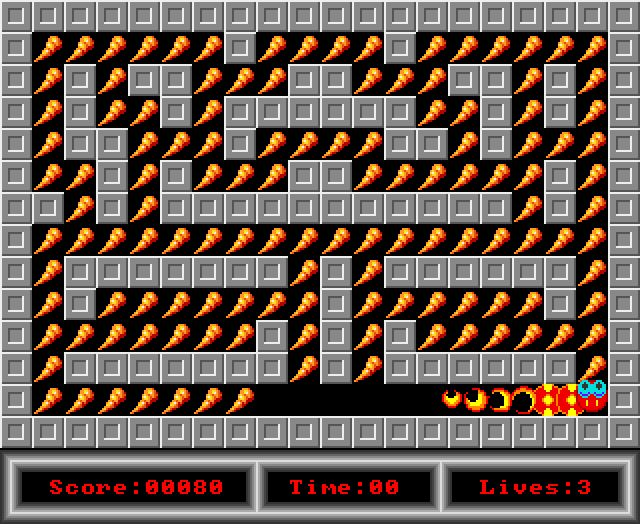

# Nibby Nibble — native Java version

[Version française](README.fr.md)

Native Java version of the Amiga game **Nibby Nibble** (© 1993 Gabriele Roncolato). It was rewritten
in plain Java from the knowledge gained by decompiling the original 68000 program
(see the [emulated version](emu/README.md) in the `emu/` folder of this repository, which ports the
original code routine by routine on top of a small Amiga chipset emulation).

There is no emulation here: no 68000, no copper, no blitter, no Amiga memory. The graphics, levels and
music were **extracted** from the original data file into PNG images, text files and a `.mod` module,
and the game is plain Java code: three layers (maze, sprites, snake body) composed into a 320×262 frame,
a 32-colour palette for the fades and death effects, and a stand-alone module player.

## Repository layout

| folder | content |
|---|---|
| `/` (root) | **native Java version** (this README): extracted assets, plain Java game |
| [`emu/`](emu/README.md) | **emulated Java port**: the original 68000 routines translated one by one on top of a small Amiga chipset emulation, the original data file, the disassembly listings and the analysis tools |
| `tools/` | asset extractor (`extract_assets.py`) |

## Screenshots

| | |
|:---:|:---:|
|  |  |
| Title screen | Level 1 |
|  |  |
| Level 2 | Death: the body burns from the tail to the head |

## Faithful to the original

The behaviour was checked against the emulated version (which runs the original logic): with the same
inputs, both versions produce **pixel-identical frames** — title, cheat code, gameplay, eating, growth,
self-bite, time-out death, burning/spinning/explosion animations, end-of-level fades, level skip,
return to the title — and the **same audio** (within ±1 rounding unit of the 16-bit mix).

Details reproduced from the original code include: 2-pixel steps per frame, turns only on a tile,
walls that stop the snake, growth every 2 then 1 dots (91 segments max), the snake body drawn one
frame late (triple buffering in the original), the pixel-accurate head/body collision (only body pixels
of colour 3 count), the timer that only kills when moving at 0, the copper rainbows, the status bar
refreshed by the music routine, and the sound effects that temporarily replace channel 2 of the music.

## Preservation and educational purpose

This project exists only for the **preservation of Amiga video game heritage** and for **educational
use**. The original game, © 1993 Gabriele Roncolato, was distributed as **public domain** software on
the cover disk of the French magazine *Amiga Dream*; all credit for the game goes to its author.
The assets in `src/main/resources/assets/` were extracted unmodified from the original game data; they
are not covered by the MIT license. This project is strictly non-commercial; if a rights holder wishes
it to be taken down, just open an issue or contact the author.

Author of the Java version: Guillaume Monet (guillaume.monet@free.fr). License: [MIT](LICENSE) for the
code, tools and documentation.

## Running

Requirement: JDK 21. Nothing else: the assets are bundled in the jar.

```sh
gradle run
# or
gradle jar
java -jar build/libs/nibbynibble.jar
```

Portable Windows build with an embedded runtime: `gradle jpackageImage` (output in
`build/dist/NibbyNibble`, run `NibbyNibble.exe`).

Options: `--scale N` (window zoom, default 3), `--lives` / `--time` (unlimited lives / time trainers),
`--headless FRAMES DIR events...` (runs without a window, saves PNG frames and `audio.wav`; events are
`frame:action` with `fire|up|down|left|right|lmb|rmb|esc` followed by `+`/`-`, `key=X+`/`key=X-`
(`_` for space) or `shot`).

## Controls

| Action | Keys |
|---|---|
| move | arrow keys (or numpad 8/2/4/6) |
| fire (start) | Shift, Ctrl or Enter |
| back to title | Esc |
| quit | F10 or close the window |
| skip level (original cheat) | right click + fire + left click |

Original cheat: type `THE RONCLER GANG` on the title screen → infinite lives (and the timer stops).

## Code

```
nibby/Main.java       window, keyboard/mouse, 50 Hz loop paced by the audio line, headless mode
nibby/Game.java       the game: title, levels, movement, growth, collisions, fades, death, rendering
nibby/ModPlayer.java  4-channel module player (the game's NoiseTracker-style replay) + sound effects
nibby/Level.java      a maze loaded from levels/levelNN.txt + its two tiles
nibby/Bitmap.java     image of palette indices (cookie-cut drawing, erasing)
nibby/Assets.java     loading of the indexed PNG files and text files
nibby/Input.java      input state
```

## Assets

`tools/extract_assets.py` rebuilds `src/main/resources/assets/` from the original data file
(Python 3 + Pillow):

```sh
python tools/extract_assets.py emu/original-assets/Nibby src/main/resources/assets
```

| file | content |
|---|---|
| `title.png`, `statusbar.png`, `stage.png`, `gameover.png`, `digits.png` | screens, status bar, banners, 8×8 digits |
| `rainbow.txt` | the copper rainbow colour table |
| `levels/levelNN.txt` | dot count, time, palette and 20×14 map (`0` wall, `.` dot) |
| `levels/levelNN_wall.png`, `levelNN_dot.png` | the 16×16 tiles of each level |
| `sprites/head_*`, `tail*`, `signature.png` | head (attached sprites, 4 directions × 3 frames), tail pieces, "GR" signature |
| `shapes/body_*`, `burn_*`, `explosion_*` | body shapes and mask, burning and explosion frames |
| `nib-rsi.mod` | the music (ProTracker module, sample 16 "esplosione" and 17 "bopp" are the sound effects) |

Images are indexed PNG files: the game uses the palette indices and applies its own palettes at run time.
