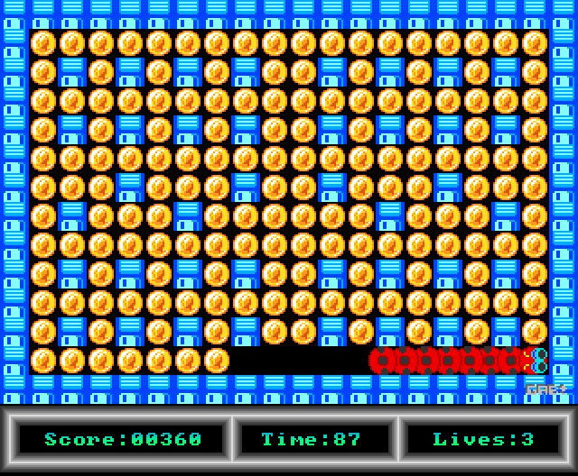
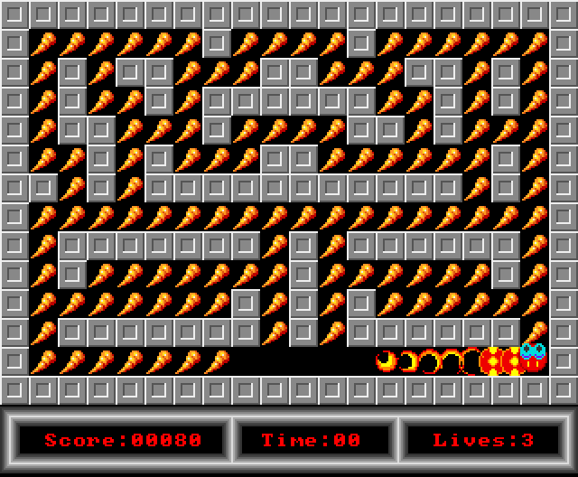
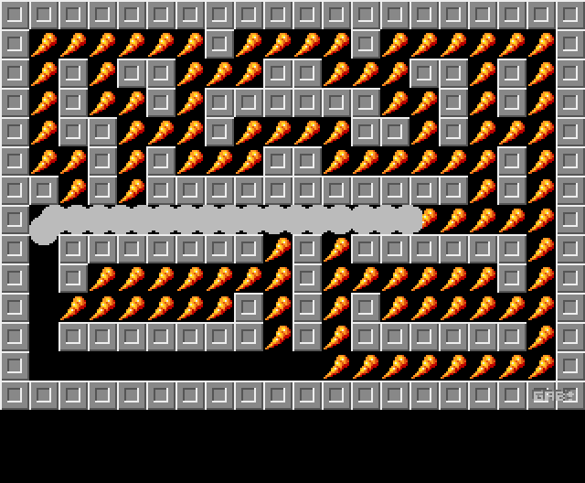
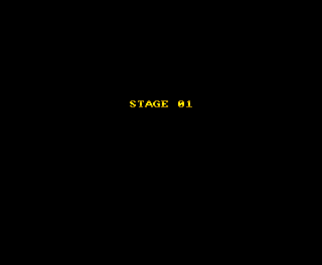

# Nibby Nibble — emulated Java port

[Version française](README.fr.md) · [Native version (repository root)](../README.md)

Java port of the Amiga game **Nibby Nibble** (© 1993 Gabriele Roncolato, presented by Amiga News),
obtained by decompiling the original 68000 program (`data/Nibby` from the WHDLoad install, kept in `original-assets/Nibby`).

This is the first step of the project: the original routines translated one by one, running on a small
emulation of the Amiga chipset. The [native version](../README.md) at the root of the repository was then
written from this work, and was checked to produce pixel-identical frames against it.

## Screenshots

Frames produced by the Java port (`--headless` mode), scaled ×2.

| | |
|:---:|:---:|
|  |  |
| Title screen | Level 1: the snake has eaten some of the dots |
|  |  |
| Level 3 | Death (time out): the body burns from the tail to the head |
|  |  |
| End of level: fade to white | "STAGE" screen shown before each level |

## Preservation and educational purpose

The sole purpose of this project is the **preservation of Amiga video game heritage** and
**educational use**: documenting the inner workings of a 1993 game (68000 code, copper, blitter,
hardware sprites, Paula), showing a complete reverse-engineering process, and keeping the game playable
on today's machines without an emulator.

- The original game, © 1993 Gabriele Roncolato, was distributed as **public domain** software on the
  cover disk of the French magazine *Amiga Dream*. All credit for the game goes to its author.
- The original data file (`data/Nibby` from the WHDLoad install, RNC packed, unmodified) is kept in
  `original-assets/` for preservation. It is not covered by the MIT license.
- This project is strictly non-commercial. If a rights holder wishes it to be taken down, just open an
  issue or contact the author: it will be removed promptly.

Port author: Guillaume Monet (guillaume.monet@free.fr).

### License

The Java code, Python tools and documentation in this repository are under the [MIT](../LICENSE) license.
The original game (public domain, *Amiga Dream* cover disk) remains credited to Gabriele Roncolato; the
disassemblies in `reverse/listings/` are provided for preservation and teaching purposes.

## The port

The game is **not** a loose remake: every routine of the 68000 program was translated into a Java
method (the original address is given in a comment). The resources (graphics, copper lists, levels,
music module) are read directly from the original data file, kept as is in `original-assets/Nibby`:
nothing is extracted or converted.

## Running

Requirement: JDK 21. From the `emu/` folder:

```sh
gradle run
# or
gradle jar
java -jar build/libs/nibbynibble-emu.jar            # looks for original-assets/Nibby
java -jar build/libs/nibbynibble-emu.jar path/to/Nibby
```

Windows builds of this emulated version (Java runtime included) are the releases
[v1.0.0 and v1.0.1](https://github.com/guillaumemonet/nibbynibble-java/releases). To rebuild one:
`gradle jpackageImage` (output in `build/dist/NibbyNibble`).

Options:

| option            | effect                                                         |
|-------------------|----------------------------------------------------------------|
| `--scale N`       | window zoom factor (default 3)                                 |
| `--lives`         | "Unlimited Lives" trainer from the WHDLoad install             |
| `--time`          | "Unlimited Time" trainer                                       |
| `--headless N DIR evt...` | runs N frames without a window, saves PNGs and `audio.wav` (testing) |

Headless example: `--headless 700 out 100:fire+ 110:fire- 200:fire+ 205:fire- 320:right+ 400:shot`
(`frame:action` events; actions are `fire|up|down|left|right|lmb|rmb` followed by `+`/`-`,
an Amiga raw key code in hex, or `shot`).

## Controls

| Amiga                      | PC                                  |
|----------------------------|-------------------------------------|
| joystick                   | arrow keys (or numpad 8/2/4/6)      |
| fire button                | Shift, Ctrl or Enter                |
| ESC (back to title)        | Esc                                 |
| quit (F10 under WHDLoad)   | F10 or close the window             |
| right click + fire + left click | same with the mouse: skips the level (original cheat) |

Original cheat: type `THE RONCLER GANG` on the title screen → infinite lives (and the timer stops).

## Rules (derived from the code)

- 20×14 maze of 16×16 tiles; 10 levels that loop (level 11 is level 1 again).
- Eat all the dots before the timer runs out. Each dot is worth 1 (displayed ×10).
- The snake grows by one segment every 2 then 1 dots, alternately (91 segments maximum).
- Walls do not kill: the snake just stops. You can only turn at right angles, on a tile.
- You die by biting yourself (hardware collision between the head sprite and the body playfield),
  or by moving while the timer is at 0. The level then restarts (dots come back, the score is kept).
  You start with 3 spare lives.

## Architecture

```
nibby/Main.java              launcher, Swing window, 50 Hz loop paced by audio, headless mode
nibby/amiga/Rnc.java         Rob Northen ProPack (method 1) decompressor — data/Nibby is packed
nibby/amiga/Memory.java      512 KB of chip RAM; the program image is loaded at $30000
nibby/amiga/Custom.java      $DFFxxx registers (written by the game and by the copper)
nibby/amiga/Video.java       copper + bitplanes (dual playfield) + (attached) sprites + CLXDAT → 320×264 framebuffer
nibby/amiga/Blitter.java     blitter (A/B/C/D channels, shifts, masks, minterms)
nibby/amiga/Paula.java       4 DMA audio voices with the register "latch" behaviour
nibby/amiga/Machine.java     synchronisation: the ported 68000 program runs in its own thread
                             and waits for the VBL just as the original waited for the beam
nibby/game/NibbyNibble.java  the game: title, levels, movement, growth, death, fades, HUD
nibby/game/Replay.java       the original music routine (NoiseTracker style) + sound effects on voice 2
```

Rather than redrawing the screen with Java2D primitives, the port keeps the original display model:
the game writes into copper lists and sprite control words, and has the body drawn by the blitter
through a copper list generated every frame. A small chipset emulation (line-by-line copper, blitter,
sprites, collision detection) is then enough to faithfully render the copper gradients, the dual
playfield and the pixel-accurate collisions that the "bite your own tail" rule depends on.

## Analysis of the original binary

### Loading (`NibbyNibble.slave`, see `reverse/listings/whdload_slave.s`)

The WHDLoad slave loads `data/Nibby` unpacked (RNC) at `$30000`, applies patches (blitter waits,
keyboard: arrows + right Shift, interrupts) then jumps to `$30000`.
Trainers: NOP of `subi #1,$31896` (lives) and of `subi #1,$31898` (time).

### Memory map (256 KB image loaded at `$30000`)

| address           | content                                                                    |
|-------------------|----------------------------------------------------------------------------|
| `$30000-$31818`   | game code                                                                  |
| `$3181A`          | keyboard interrupt (raw code → `$3188A`)                                   |
| `$31878`          | cheat sequence (`THE RONCLER GANG`, raw key codes)                         |
| `$3188A-$31912`   | variables (see the fields of `NibbyNibble`)                                |
| `$31956`          | game copper list (dual playfield 3+2 planes, sprites, palette)            |
| `$31A76`          | death copper list                                                          |
| `$31BFA` / `$31C66` | "STAGE nn" / "GAME OVER" screens                                         |
| `$31CD2`          | status bar copper list                                                     |
| `$31D6E`          | title copper list (180 lines of gradient on COLOR14)                       |
| `$323D2`          | rainbow colour table                                                       |
| `$32484-$33304`   | head sprites (4 directions × 3 frames, attached pairs), tail sprites       |
| `$32FC4-$33784`   | body shapes (32×16, 2 planes), mask, explosion frames                      |
| `$33B04`          | empty tile; `$33B64` working copy of the level                             |
| `$33C7C-$34B90`   | 10 levels: descriptor {map, wall tile, dot tile, palette}, map = dot count, time, 20×14 characters (`0` wall, `.` dot) |
| `$34CBC/$34DFC/$35214` | X shift/offset and Y offset tables for the blitter                    |
| `$35194`          | 8×8 digit font                                                             |
| `$35418-$366D8`   | circular position history (600 entries, mirrored for reading)              |
| `$366D8-$36F66`   | music replay + CIA interrupts                                              |
| `$38000`          | title picture (4 planes 320×200)                                           |
| `$40000`          | ProTracker module "nib-rsi" (sample 16 "esplosione", 17 "bopp")            |
| `$57800`          | status bar (3 planes 320×37)                                               |
| `$5E000/$5F000`   | body blit copper lists (double buffered, generated)                        |
| `$60000/$65000/$6A000` | 3 body playfield buffers (triple buffering)                           |
| `$70000`          | maze playfield (3 interleaved planes)                                      |

### Tools (`reverse/tools`)

Python scripts used for the analysis (Python 3 + `capstone` + `pillow`):

- `rnc.py original-assets/Nibby nibby.bin` — decompression (256 KB image loaded at `$30000`);
- `m68kdis.py nibby.bin start end base` — linear 68000 disassembly (e.g. `0 0x3b64 0x30000`);
- `copper.py nibby.bin address [n]` — copper list decoding.

The extraction of all the graphics, levels and music is done by
[`tools/extract_assets.py`](../tools/extract_assets.py) of the native version.

The disassembly listings are in `reverse/listings`.

## Known differences

- The Amiga low-pass filter (E0x command) is not emulated; the audio output is a direct stereo mix of
  the 4 voices, with a slight crossfeed.
- Timing is per frame (50 Hz): raster waits and blits are instantaneous.
